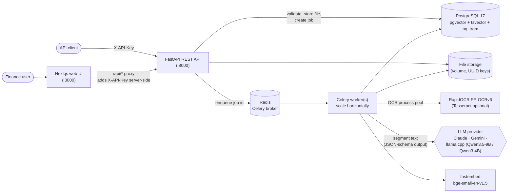

# Architecture

## Components



## Processing pipeline (one background job per document)

```mermaid
sequenceDiagram
    participant UI as Web UI / client
    participant API as FastAPI
    participant DB as PostgreSQL
    participant Q as Redis (Celery)
    participant W as Worker
    participant L as LLM (optional)
    UI->>API: POST /api/v1/documents (many files)
    API->>API: size/count limits, magic-byte type check, sha256
    API->>DB: documents + processing_jobs (queued)
    API->>Q: enqueue(job_id)
    API-->>UI: 202 per-file results (queued / rejected / duplicate)
    Q->>W: job_id (acks_late, retries with backoff)
    W->>DB: job running, event "started"
    W->>W: parse — PDF words + per-page OCR fallback / images / sheets
    W->>DB: document_pages, progress per page (heartbeat)
    W->>W: segment long PDFs into invoices
    par per segment
        W->>W: rules extractor (layout-aware)
        W->>L: verbatim JSON extraction
        L-->>W: values as printed
        W->>W: grounding (reject values not in the text) → merge + arithmetic reconciliation
    end
    W->>W: validation rules, duplicates, cross-verification (PDF↔PDF, PDF↔Excel)
    W->>DB: invoices, validation_issues, cross_verifications
    W->>W: chunk + embed (pages and invoice summaries)
    W->>DB: chunks (vector + tsvector)
    W->>DB: status completed / needs_review / failed, timings, event "completed"
    UI->>API: poll GET /documents/{id}/status, then results; PATCH corrections; search
```

## Extraction design — accuracy without invented values

1. **One layout model for every input.** Digital PDF words (PyMuPDF) and OCR text boxes both become
   `Span → Line → Page` with coordinates, so the same extractor handles digital and scanned documents.
2. **Rules extractor (always runs, no network).** Label vocabularies with look-alike exclusions ("Tax Invoice",
   "VAT No", "Net 30" are not amounts), geometric key→value search (same line, else below the label), locale-aware
   money/date parsing with document-level hints (decimal separator, day/month order), line-item tables from header
   columns, multi-tax summing.
3. **LLM extractor (when configured).** The model copies each value **verbatim** under a strict JSON Schema
   (structured outputs on Claude/Gemini, grammar-constrained decoding on llama.cpp). Our parsers normalise the
   verbatim strings — a live test showed small local models null out amounts when asked to normalise them, but copy
   them perfectly. The document is framed as untrusted data; injected instructions are ignored.
4. **Grounding.** Any LLM value that does not occur in the source text (or does not parse) is rejected to `null`
   and reported (`UNGROUNDED_VALUE_REJECTED`). Values are never computed to fill gaps.
5. **Merge and reconciliation.** Agreement raises confidence; disagreements are resolved by arithmetic consistency
   (line items → subtotal → tax → total) and flagged `EXTRACTION_DISAGREEMENT`.
6. **Validation** turns every remaining doubt into an explicit, typed issue; any error or warning sends the record to
   the review queue.

## Key decisions and trade-offs

| Decision | Alternatives considered | Why this one | Cost / revisit when |
|---|---|---|---|
| Python FastAPI backend | NestJS + Python OCR microservice | OCR, pandas/openpyxl, PyMuPDF and LLM SDKs are Python; one language, no cross-service hop per page | A Node team would prefer NestJS; the REST contract is language-neutral |
| Celery + Redis, job state in Postgres | BullMQ (Node), RQ (no Windows), Postgres SKIP LOCKED queue | Brief suggests Redis; Celery gives acks-late redelivery and retries; DB state makes the broker disposable | Very high volume → partition queues per stage |
| PostgreSQL + pgvector + FTS | MongoDB + dedicated vector DB | Transactions across results/issues/index; one system to run; HNSW is fast at this scale | Tens of millions of chunks → dedicated vector store or partitioning |
| RapidOCR (PP-OCRv6) default | Tesseract, EasyOCR (PyTorch), cloud OCR | Pure pip, accurate on noisy scans, CPU-only; Tesseract kept as an option | Handwriting or non-Latin scripts → specialised OCR/VLM |
| Hybrid rules + LLM with grounding | LLM only; rules only | Works offline; LLM adds robustness on unseen layouts; grounding prevents hallucinations | A learned layout model if many unusual layouts appear |
| Local llama.cpp provider | API-only | Confidential financial documents never leave the machine; zero marginal cost | Claude/Gemini for maximum accuracy when policy allows |
| fastembed bge-small (384-d) in-process | OpenAI/Voyage embeddings, larger local models | No server, fast on CPU, good retrieval quality | Multilingual corpora → multilingual embedding model |
| Next.js with a server-side proxy | SPA calling the API directly | Keeps the API key off the browser; same-origin requests (no CORS in the UI path) | — |

## Scalability and reliability

- **Horizontal workers:** `docker compose up --scale worker=N`; each worker runs `OCR_WORKERS` OCR processes.
  The API stays responsive because uploads only store, hash and enqueue.
- **Large documents:** pages are parsed and OCR'd one at a time in a process pool (memory bounded by one rendered
  page per OCR process); segmentation bounds each LLM call to one invoice; progress and heartbeat update per page.
- **At-least-once delivery, idempotent jobs:** `acks_late` redelivers a job whose worker died; processing a
  document replaces its results in one transaction, so a redelivery cannot duplicate records. A sweeper in every worker
  (at start, then every minute) re-queues jobs whose worker stopped sending heartbeats and re-sends `queued` jobs whose
  broker message was lost.
- **Failure isolation:** a corrupt page becomes an empty page with a warning; a corrupt file fails with a typed
  error code; an LLM outage falls back to rules (`LLM_UNAVAILABLE`); transient DB errors retry with backoff.
- **Observability:** structured JSON logs (IDs, codes, timings — never document contents), `processing_events`
  history, `/api/v1/stats`, `/api/v1/ready` (DB, queue, LLM).

## Security

See `docs/SECURITY.md`: API keys (constant-time compare, refused defaults in production), upload hardening
(size/count limits, magic bytes, UUID storage paths, decompression and zip-bomb guards, page/row limits,
`defusedxml`), ORM-only SQL, rate limits, CORS allow-list, security headers, prompt-injection controls, non-root
containers, secrets only via environment.
