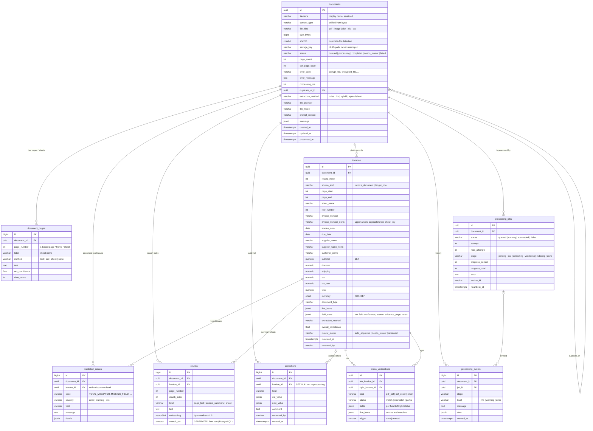

# Database schema

PostgreSQL 17 with the `vector` (pgvector) and `pg_trgm` extensions. One database holds document metadata, extracted
text, structured results, validation issues, processing history, the correction audit trail and the search index
(full-text + vectors), so a document's state changes in one transaction. Models: `backend/app/db/models.py`;
migrations: `backend/alembic/`; PostgreSQL-only DDL (extensions, generated tsvector, HNSW/GIN/trigram indexes):
`backend/app/db/pg_extras.py`. Tests and local development can run the same models on SQLite (search then uses a
Python fallback).

## Entity–relationship diagram

## Tables

| Table | Purpose |
|---|---|
| `documents` | One row per uploaded file: what it is (sniffed type, hash), where it is stored, its processing outcome and timings. |
| `document_pages` | Extracted text per PDF page, image frame or spreadsheet sheet, with the method used (digital text vs OCR) and OCR confidence — the raw material for review, search and re-extraction. |
| `invoices` | One structured record per invoice found (a long PDF can hold hundreds; a ledger sheet one per row). Typed columns serve filtering and validation; `field_meta` keeps per-field confidence, source (rules / LLM / both / spreadsheet / manual), verbatim evidence and notes. |
| `validation_issues` | Every rule violation with code, severity, field and numeric details. `invoice_id IS NULL` marks document-level issues (duplicate file, low OCR quality, LLM unavailable). |
| `corrections` | Append-only audit trail of manual corrections (who, when, old → new, why). Survives re-processing. |
| `processing_jobs` | Background job state: attempts, stage, page progress, heartbeat (stale-job recovery), error. |
| `processing_events` | Processing history: one row per stage transition or notable event. |
| `chunks` | Search index: page-text windows and invoice summaries with a 384-d embedding and a generated `tsvector`. |
| `cross_verifications` | Field-by-field comparison of two records sharing an invoice number (PDF↔PDF, PDF↔Excel ledger), automatic or user-requested. |

## Indexes and why

| Index | Serves |
|---|---|
| `documents (status, created_at)` | dashboard lists and status filters |
| `documents (sha256)` | duplicate-file detection at upload |
| `documents (file_kind)`, `(duplicate_of_id)`, `(created_at)` | list filters and duplicate lookups |
| `invoices (invoice_number_norm, supplier_name_norm)` | duplicate detection and cross-verification lookups |
| `invoices (invoice_date)`, `(total)`, `(currency)`, `(review_status)` | keyword/structured filters and the review queue |
| GIN trigram on `invoices.supplier_name`, `invoices.customer_name` | fast case-insensitive substring filters (`ILIKE '%acme%'`) |
| GIN on `chunks.search_tsv` | full-text keyword search (`websearch_to_tsquery`, `ts_rank_cd`) |
| HNSW (`vector_cosine_ops`) on `chunks.embedding` | approximate nearest-neighbour semantic search |
| FKs on every `document_id` / `invoice_id` | cascades and per-document reads |

## Integrity rules

- Deleting a document cascades to its pages, records, issues, jobs, events, chunks and comparisons.
- Re-processing replaces a document's pages, records, issues, chunks and comparisons in one transaction; corrections
  stay (their `invoice_id` becomes NULL) so the audit trail is never lost.
- Money is `NUMERIC(18,4)` (never floating point); currency is a 3-letter ISO code.
- `(document_id, page_number)` and `(left_invoice_id, right_invoice_id)` are unique.
